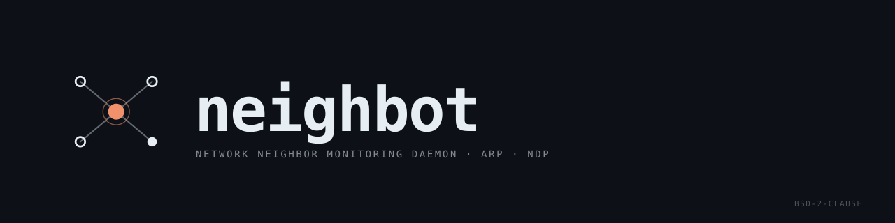

<p align="center">
  
</p>

<p align="center">
  <a href="https://github.com/renaudallard/neighbot/releases/latest">
    
  </a>
  <a href="https://github.com/renaudallard/neighbot/releases">
    
  </a>
  <a href="https://github.com/renaudallard/neighbot/actions/workflows/valgrind.yml">
    
  </a>
  <a href="https://github.com/renaudallard/neighbot/actions/workflows/fuzz.yml">
    
  </a>
  
  <a href="./LICENSE">
    
  </a>
  <a href="https://www.paypal.me/RenaudAllard">
    
  </a>
</p>

---

Like [arpwatch](https://ee.lbl.gov/), but also handles IPv6 and runs on
Linux, FreeBSD, OpenBSD, and NetBSD.

## Features

| | |
|---|---|
| **Protocols** | ARP (IPv4), NDP (IPv6) |
| **Events** | New stations, MAC changes, flip-flops, reappearances, bogons, fragmented ND, moves |
| **Notifications** | Email via sendmail with hostname, vendor, and timestamps |
| **Active probing** | ARP requests / NDP solicitations to detect moved vs. multi-homed hosts |
| **OUI database** | Optional hardware vendor identification from MAC prefix |
| **Storage** | Plain CSV with atomic saves (temp file + rename) |
| **VLAN trunks** | Auto-detects VLAN subinterfaces and skips trunk parents that have no address besides link-local ones; on Linux also skips bridge ports, bond slaves and macvlan or macvtap devices, and on OpenBSD carp interfaces |
| **Sandboxing** | `pledge(2)` + `unveil(2)` on OpenBSD, privilege drop everywhere |
| **Portability** | Linux (glibc, musl), FreeBSD, OpenBSD, NetBSD |

Single-threaded, single binary, no dependencies beyond libpcap.

## Quick Start

```sh
make
sudo ./neighbot -q -u "$USER" -f ./neighbot.csv
```

This runs as you once the captures are open, and keeps the database in
the current directory: not in `/tmp`, where another user could create the
file or its temporary copy first and make every save fail.

Then generate some traffic (`arping`, `ping`) and watch the log output.

## Build

Requires a C compiler, make and libpcap. `make install` also downloads the
OUI database unless `oui.txt` is already present in the source tree, so it
needs network access the first time. It uses `curl` where installed, else
`fetch` on FreeBSD or `ftp` on OpenBSD and NetBSD, from the base system.

The usual `CPPFLAGS`, `CFLAGS` and `LDFLAGS` are honoured.
`-D_FORTIFY_SOURCE=2` is added unless they already set a fortify level,
so a distribution's own level is kept.

| OS | Install libpcap |
|----|-----------------|
| Debian / Ubuntu | `apt install libpcap-dev` |
| Alpine | `apk add libpcap-dev` |
| Fedora / RHEL | `dnf install libpcap-devel` |
| FreeBSD / OpenBSD / NetBSD | included in base |

```sh
make
```

## Install

```sh
sudo make install          # binary + man page + OUI database
sudo make install-systemd  # + systemd unit (Linux)
sudo make install-rcd      # + rc.d script (OpenBSD)
make oui-update            # re-download oui.txt (then make install)
```

Installs to `/usr/local/sbin` by default, with the manual page under
`PREFIX/share/man` (`PREFIX/man` on OpenBSD and NetBSD, where `man` looks
for it). Override with `PREFIX`, `BINDIR` or `MANDIR`. The database
directory is always `/var/neighbot`; use `-f` and `-o` to keep the files
elsewhere:

```sh
sudo make PREFIX=/usr install
```

Uninstall, after `sudo systemctl disable --now neighbot` (or `rcctl stop
neighbot` and `rcctl disable neighbot` on OpenBSD) if the service was enabled,
since `make uninstall` only removes files:

```sh
sudo make uninstall
```

### Pre-built packages

Packages are built automatically for each GitHub release and attached as
release assets. Supported distributions:

| Format | Distributions |
|--------|---------------|
| `.deb` | Ubuntu (latest supported interim release, if any, and LTS), Debian (stable, oldstable) |
| `.rpm` | Fedora, Rocky Linux (2 versions), openSUSE Leap, SUSE BCI |
| `.apk` | Alpine Linux |
| `.tgz` | OpenBSD (2 latest supported releases) |

Install with your package manager, which also pulls in libpcap:

```sh
sudo apt install ./neighbot_*.deb                      # Debian/Ubuntu
sudo dnf install ./neighbot-*.rpm                      # Fedora/RHEL
sudo zypper install --allow-unsigned-rpm ./neighbot-*.rpm  # openSUSE/SUSE
sudo apk add --allow-untrusted neighbot-*.apk          # Alpine
doas pkg_add -D unsigned ./neighbot-*.tgz              # OpenBSD
```

The `.deb` enables and starts the service on install. The `.rpm` installs
the unit but leaves it disabled (`sudo systemctl enable --now neighbot`).
The `.apk` ships no init script, and on OpenBSD use `rcctl enable neighbot`.
The OpenBSD rc script reads vendor names from the file of the `mac-vendor`
package (`doas pkg_add mac-vendor`); without it, alerts show no vendor.

## Usage

```
neighbot [-B seconds] [-d] [-e days] [-f dbfile] [-i iface] [-m mailto] [-o ouifile] [-p] [-q] [-r] [-s sendmail] [-u user] [-V]
```

| Flag | Description |
|------|-------------|
| `-B seconds` | Bogon and fragment log and notification cooldown in seconds (default: 1800). Set to 0 to disable the per-address cooldown (a global flood cap still applies) |
| `-d` | Daemonize (log to syslog instead of stderr; errors before detaching are printed on stderr too) |
| `-e days` | Drop entries unseen for more than `days` days (checked hourly). 0 disables (default); the 7-day stale non-EUI-64 IPv6 sweep runs regardless. Below 180, a station back after a long silence is reported as new, as its entry is gone already, unless it is back before the first check, normally an hour after the start |
| `-f dbfile` | Database file (default: `/var/neighbot/neighbot.csv`) |
| `-i iface` | Monitor only this interface (default: all Ethernet interfaces) |
| `-m mailto` | Email recipient (default: `root`) |
| `-o ouifile` | OUI vendor database file (default: `/var/neighbot/oui.txt`) |
| `-p` | Disable active probing (passive only) |
| `-q` | Quiet mode. No email notifications, events are still logged |
| `-r` | Report mode. Print database summary to stdout (or email with `-m`; a `sendmail` still running after two minutes gets `SIGALRM`, which ends it unless it catches the signal, as Exim does), then exit |
| `-s sendmail` | Path to sendmail-compatible MTA (default: `/usr/sbin/sendmail`) |
| `-u user` | Drop privileges to this user after opening pcap handles (default: `nobody`) |
| `-V` | Print the version number and exit |

### Examples

```sh
# Foreground, quiet, custom DB in your home directory
sudo neighbot -q -u "$USER" -f "$HOME/neighbot.csv"

# Daemon with email alerts
sudo neighbot -d -u neighbot -m admin@example.com

# Single interface, no probing
sudo neighbot -d -i eth0 -p

# Print database report to stdout
sudo neighbot -r -f /var/neighbot/neighbot.csv

# Email database report
sudo neighbot -r -m admin@example.com
```

## Event Types

| Event | Description | Email |
|-------|-------------|-------|
| **new** | Previously unknown IP address seen for the first time | yes (suppressed for IPv6 temporary address rotations) |
| **changed** | IP seen with a different MAC than previously recorded | yes |
| **flip-flop** | IP alternates between two known MACs (VRRP/HSRP, dual-homing, or spoofing). Storm detection suppresses rapid repeats, also when three or more MACs take turns (seen as changed events), separately on each interface | yes |
| **reappeared** | Known MAC/IP pair seen again after 180 days or more of silence; for a station already seen since the start, silence is timed on the monotonic clock, so a wall-clock step does not cause it | yes |
| **bogon** | IP outside every local subnet of the monitored interfaces (possible spoofing); an IP foreign to the receiving interface but local to another monitored one is ignored, unless it is recorded on the receiving one (see below). On Linux, an IP the host reaches without a gateway through the interface, as with an on-link route holding no address of the host, is local too (at most 64 route lookups a second; past that, as in a flood of foreign addresses, an IP counts as foreign). An IP already recorded on the interface is never a bogon there, even once it has left every subnet: another MAC claiming it is reported as changed, so neither a restart nor such a flood can hide a spoof. An interface with no subnet of an address family reports no bogons for it; a /32 or /128 address, such as a DHCPv6 lease, does not count as a subnet. Subnets are re-read every minute, on `SIGHUP`, and before reporting a bogon (at most once a second) | yes |
| **fragmented** | The first fragment of an IPv6 packet carries an ND message, or headers going on into the next fragment that may hide one. RFC 6980 forbids fragmented ND, and Linux, FreeBSD and macOS drop it, but OpenBSD and NetBSD reassemble it and act on it (possible spoofing). Never stored; rate-limited like bogons, per address the message would record: the target of an NA or Redirect when the fragment holds it, the source otherwise | yes |
| **ra-learned** | IPv6 on-link prefix announced by a Router Advertisement | yes (when learned; refreshes are silent) |
| **moved** | MAC seen at a new IP while old IP no longer responds to probes. The obsolete entry is dropped. When the new IP is on another interface, both interfaces are named | yes |

## Active Probing

When a known MAC appears at a new IP, neighbot sends up to 3 probes (5s
timeout each) to each old IP of the same address family associated with that
MAC (dual-stack hosts are not probed across IPv4/IPv6):

- **IPv4**: ARP request sent from the interface's own address, preferably
  one in the target's subnet
- **IPv6**: NDP Neighbor Solicitation sent from the interface's link-local
  address, with a Source Link-Layer Address option

A zero source address is not used: it is what a duplicate address check
looks like (RFC 4862, RFC 5227), and a host that is just bringing up the
probed address would give it up. An interface with no IPv4 address other
than a link-local one, or no IPv6 link-local address, still sends from
`0.0.0.0` or `::`.

| Outcome | Meaning | Action |
|---------|---------|--------|
| Probe answered | Device has multiple IPs | Log only |
| Probe timed out | Device moved to new IP | Log + email |
| Another MAC answers at the old IP | Device moved, its old IP taken over (also reported as changed) | Log + email |
| Probe timed out with the link down | Unknown (probes were not delivered) | Log only |

Link-local addresses (fe80::/10, 169.254/16) are excluded from probing
since every IPv6 interface has one alongside its global address.
IPs assigned to the local host's own interfaces are also excluded,
preventing false "moved" alerts when the host has multiple IPs across
VLANs or other interfaces.

Disable probing with `-p` for purely passive monitoring.

**IPv6 temporary addresses (RFC 4941):** When a device using privacy
extensions rotates its temporary address, neighbot detects that the same
MAC already has a non-EUI-64 address in the same /64 prefix on the same
interface and suppresses
the "new station" email. Older temporary addresses are not dropped at that
point, since a spoofed address from the owner's MAC could otherwise clear
the way for another MAC to take one over unreported. They are not probed
either, nor are the device's other non-EUI-64 addresses on that interface,
such as temporaries in a ULA prefix next to the global one, since they
expire on their own, and they are reaped by the stale non-EUI-64 sweep
below. This also covers link-local address rotation
(common on devices with randomized MACs), although link-local entries are
only removed by `-e` idle expiration. At most 256 addresses per MAC
are tracked; a flood of addresses under one MAC beyond that is ignored
(logged once per run), which a legitimate neighbor never reaches. An address moving
to a MAC already at the limit is still reported as changed but keeps its
previous MAC in the database, and extra rows in an older database file are
skipped at load. This
handling does not depend on probing and also applies with `-p`.

## Obsolete Address Cleanup

neighbot removes entries it knows are no longer valid:

| Source | Trigger | Notification |
|--------|---------|--------------|
| Probe timeout | Old IP no longer responds at the recorded MAC after a probe fires | "moved" email |
| Stale non-EUI-64 IPv6 | Non-EUI-64, non-link-local IPv6 entry unseen for more than 7 days, checked once per hour | silent (logged only) |
| Idle expiration (`-e days`) | `last_seen` older than `days` days, checked once per hour | silent (logged only) |

Both sweeps run once an hour. A sweep that comes an hour or more late, as
when the wall clock jumps forward because NTP sets the clock of a board
without RTC after the start or the host resumes from suspend, waits
another hour instead, so stations seen before the jump are not taken for
idle ones; the systemd unit also starts after `time-sync.target`. A
last-seen time recorded since the start while the clock was ahead goes
back with the clock once it is set right, so that entry still expires,
but none goes back past the time read from the database, which a clock
still behind at the start would replace otherwise: one written there
while the clock was ahead stays until the clock reaches it.

This reaping is always on so that RFC 4941 privacy addresses left behind
by an offline device or a prefix change do not linger in the `also known
as` line of later notifications. The test is purely the address shape:
any non-EUI-64, non-link-local IPv6 address qualifies. That also covers
RFC 7217 stable-privacy, DHCPv6, and manually assigned global addresses,
which cannot be told apart from privacy addresses by inspection. A host
that keeps such an address but stays silent for more than 7 days has its
entry dropped and is reported as a new station when it reappears. EUI-64
and link-local addresses are never reaped this way. The broader `-e` idle
expiration remains opt-in: without `-e`, non-temporary entries are kept
indefinitely unless a probe confirms the IP is gone.

## IPv6 Prefix Learning (Router Advertisements)

neighbot listens for ICMPv6 Router Advertisements and records every on-link
prefix announced by a router on each interface (Prefix Information Option
with the L flag set, RFC 4861). Addresses that match a learned prefix are
treated as local and no longer produce bogon alerts, even when the host
itself has no IPv6 address configured on that interface.

The first time a new prefix is learned on an interface, neighbot sends an
**ra-learned** notification so the operator is aware of the new subnet; a
prefix inside a subnet the host has configured on that interface, or a
/64 or longer holding a /128 address of the host there (such as a DHCPv6
lease), is only logged, so restarts do not re-announce it.
Subsequent refreshes of the same prefix are silent; a prefix that expired,
was withdrawn or was evicted is reported again when it is announced again. Prefix entries expire
after the RA valid-lifetime (capped at 7 days), and a prefix re-advertised
with the L flag and a zero valid-lifetime is withdrawn immediately. Prefix
options without the L flag are ignored, withdrawals included, as RFC 4861
requires. A prefix option whose preferred lifetime exceeds the valid one
is learned, as FreeBSD 14 makes the prefix on-link from it, but it never
withdraws the prefix or shortens its lifetime, as Linux, macOS and newer
FreeBSD ignore it (RFC 4862).

Incoming Router Advertisements are validated per RFC 4861: only RAs with
an IPv6 hop limit of 255 and a link-local source address are accepted, so
off-link or spoofed advertisements are dropped. A rogue RA sent by an
on-link attacker can still suppress bogon alerts for the prefix it
announces. The first-learn notification surfaces that event, and
deployments that already run RA-Guard or similar L2 filtering retain
protection. Prefixes shorter than /48 are ignored (and logged), so a
rogue RA cannot whitelist a wide slice of the address space with a single
short prefix.

## Service Setup

Capture handles cannot be reopened after dropping privileges, so an
interface that disappears (a USB adapter unplugged, an interface deleted or
renamed) is no longer monitored. When monitoring all interfaces, the others
keep being watched, so interfaces of VMs and containers coming and going
do not disturb the daemon; a re-created interface is picked up at the next
restart. neighbot exits with status 1 when the interface given with `-i`,
or the last monitored one, disappears. The systemd unit then restarts it
(giving up after 10 failures within 10 minutes, so a permanent error does
not loop forever); under OpenBSD rc.d, restart it with `rcctl`.

<details>
<summary><b>Linux (systemd)</b></summary>

```sh
sudo make install-systemd
sudo systemctl daemon-reload
sudo systemctl enable --now neighbot
```

To change options, for example to enable email, which the unit's `-q`
turns off, run `sudo systemctl edit neighbot` and replace the command in
the drop-in it opens:

```ini
[Service]
ExecStart=
ExecStart=/usr/local/sbin/neighbot -m admin@example.com
```

The empty `ExecStart=` clears the unit's own command. Use the path that
`systemctl cat neighbot` shows (`/usr/sbin/neighbot` for the packages,
`/usr/bin/neighbot` on Fedora). Unlike an edit of the unit file itself,
the drop-in is kept when the unit is installed again, by
`make install-systemd` (`/etc/systemd/system`) or by a package
(`/usr/lib/systemd/system`, or `/lib/systemd/system` on Debian
bookworm).

</details>

<details>
<summary><b>OpenBSD (rc.d)</b></summary>

The rc script runs neighbot as `_neighbot`. The `.tgz` package creates
that user; when installing from source, create it first (uid 904, as in
the ports tree):

```sh
doas groupadd -g 904 _neighbot
doas useradd -u 904 -g _neighbot -c "neighbot daemon" -d /var/empty \
    -s /sbin/nologin _neighbot
doas make install-rcd
doas rcctl enable neighbot
doas rcctl start neighbot
```

Override flags in `/etc/rc.conf.local`. They replace the script's default
flags, so keep `-u _neighbot` (`-d` is already part of the rc script):

```
neighbot_flags=-u _neighbot -o /usr/local/share/arp-scan/ieee-oui.txt -m admin@example.com
```

</details>

## OUI Database

The OUI vendor database is optional and installed by `make install` to
`/var/neighbot/oui.txt`. It is loaded once at startup. If the file is not
found, a warning is logged and neighbot continues without vendor names.

Two file formats are supported:

| Format | Example | Source |
|--------|---------|--------|
| neighbot | `aa:bb:cc Vendor Name` | `make oui.txt` (`make oui-update` refreshes it) |
| arp-scan | `AABBCC\tVendor Name` | `mac-vendor` package (`net/arp-scan,-mac`) |

On OpenBSD, install the `mac-vendor` package and point neighbot at
`/usr/local/share/arp-scan/ieee-oui.txt`.

To keep the bundled format current, add a daily job to `/etc/crontab`
(one line). It runs as the user neighbot drops to (`nobody` by default),
which owns `/var/neighbot`, so root never writes into a directory an
unprivileged user controls, and the file is only replaced by a complete
download. The OpenBSD rc script reads the `mac-vendor` file instead, which
`pkg_add -u` keeps current; if you point it at `/var/neighbot/oui.txt`,
run the job as `_neighbot`, the user of the rc script, as `nobody` cannot
enter the directory there:

```
0 3 * * * nobody cd /var/neighbot && curl -fsSL -o oui.raw https://standards-oui.ieee.org/oui/oui.txt && awk '/\(hex\)/ { gsub(/-/,":",$1); v=""; for(i=3;i<=NF;i++) v=v(i>3?" ":"")$i; print tolower($1)" "v }' oui.raw > oui.new && test -s oui.new && mv oui.new oui.txt; rm -f oui.raw oui.new
```

On Alpine, whose busybox `crond` reads no `/etc/crontab`, add the line
without the user field to the crontab of `nobody` instead, with
`crontab -u nobody -e`. Where `curl` is not installed, replace
`curl -fsSL -o` with `wget -q -O` on Alpine, `fetch -q -o` on FreeBSD or
`ftp -o` on OpenBSD and NetBSD.

neighbot will pick up the new data on its next restart.

## Database Format

Plain CSV stored at `/var/neighbot/neighbot.csv` by default, one line per
entry with the fields `ip`, `mac`, `interface`, `first_seen`, `last_seen` and
`prev_mac`, and no header line:

```
192.168.1.1,aa:bb:cc:dd:ee:ff,eth0,2026-02-23T14:30:00,2026-02-23T15:12:00,00:00:00:00:00:00
fe80::1,11:22:33:44:55:66,eth0,2026-02-23T14:30:05,2026-02-23T15:12:05,00:00:00:00:00:00
```

Timestamps are ISO 8601, local time with no UTC offset, so a time in the
hour repeated when daylight saving time ends is ambiguous and may be read
back an hour off. `first_seen` is never written later than `last_seen`, as
it would be for a station first seen while the clock was ahead, though in
that repeated hour the two can look reversed. The `prev_mac` field stores
the previous MAC address for flip-flop detection. Old database files
without this field are loaded without errors. Fields are not quoted, so
interfaces whose name contains a comma or a non-printable character are
not monitored.

Saves are atomic (write to temp file + rename). The file is written after
each event, at least once an hour while last-seen times change, on
`SIGHUP` and at shutdown, but no sooner than 10 seconds after the previous
save except at shutdown, so that a burst of events is written once. The
entry limit is
100,000 to prevent memory exhaustion from spoofed traffic. If the file
exists but cannot be read in full (read error, not a regular file),
neighbot exits instead of starting with a partial table that the next
save would write over the file.

## Signals

| Signal | Action |
|--------|--------|
| `SIGHUP` | Save database to disk (no sooner than 10 seconds after the previous save), clear storm suppression and re-read interface addresses |
| `SIGTERM` / `SIGINT` | Save database and exit |
| `SIGUSR1` | Dump active probe state to the log |
| `SIGPIPE` | Ignored |

## Security

neighbot drops to an unprivileged user (default: `nobody`) after opening
pcap handles. All supplementary groups are dropped. The default database
directory `/var/neighbot` is chowned to that user and set to mode 0750
before switching; a directory given with `-f` is left untouched and must be
writable by the target user. The database file itself is never chowned by
root: saves replace it with a file created by the target user. Since that
user can write the database and OUI files, control characters (C0 and C1)
and invalid UTF-8 in vendor names are replaced, and database rows whose
interface field is not printable ASCII are skipped, so they cannot inject
terminal escapes into a report or an alert.

On OpenBSD, neighbot additionally restricts itself using `pledge(2)` and
`unveil(2)`:

| Mode | pledge | unveil |
|------|--------|--------|
| Quiet (`-q`) | `stdio rpath wpath cpath route` | DB directory only |
| With email | `stdio rpath wpath cpath route proc exec dns` | disabled |
| Report (`-r`) | `stdio`, or `stdio proc exec` with `-m` but not `-q` | not used |

All pcap/BPF handles are opened before pledge, so no `bpf` promise is needed.
`route` lets `getifaddrs(3)` re-read the interface addresses every minute.

Each notification is delivered by a short-lived child process (reverse DNS
plus `sendmail`). To keep a flood of events (for example spoofed in-subnet
ARP) from spawning children at packet rate, no more than 32 notification
children run at once; further notifications are suppressed and logged until
the backlog clears. A child is killed after two minutes, so a stalled
resolver or mailer cannot hold the slots for good, and so is the `sendmail`
it runs, unless the mailer catches `SIGALRM` itself, as Exim does. A child
also stops on the signals that stop the daemon.

## Testing

Standalone test harnesses exercise the parser, database loader, database
expiration, OUI loader, probe packet builders, subnet matching, and
notification formatting with known inputs. They link without sanitizers so
they can run under valgrind.

```sh
make test                              # build all test binaries
tests/test_parse                       # run parser tests
tests/test_dbload                      # run database loader tests
tests/test_dbexpire                    # run database expiration tests
tests/test_ouiload                     # run OUI loader tests
tests/test_probe                       # run probe builder and state machine tests
tests/test_capture                     # run capture_is_local subnet tests
tests/test_notify                      # run format_delta and format_timestamp tests
make test-clean                        # remove test binaries
```

With valgrind:

```sh
valgrind --leak-check=full --error-exitcode=1 tests/test_parse
valgrind --leak-check=full --error-exitcode=1 tests/test_dbload
valgrind --leak-check=full --error-exitcode=1 tests/test_dbexpire
valgrind --leak-check=full --error-exitcode=1 tests/test_ouiload
valgrind --leak-check=full --error-exitcode=1 tests/test_probe
valgrind --leak-check=full --error-exitcode=1 tests/test_capture
valgrind --leak-check=full --error-exitcode=1 tests/test_notify
```

A CI workflow (`.github/workflows/valgrind.yml`) runs all tests under valgrind
on every push and pull request.

## Fuzzing

Requires clang with libFuzzer support (included in most clang packages).

```sh
make fuzz                                         # build all three fuzz targets
./fuzz_parse -close_fd_mask=2 -max_total_time=60  # fuzz the packet parser for 60s
./fuzz_dbload -max_total_time=60                  # fuzz the CSV database loader
./fuzz_ouiload -max_total_time=60                 # fuzz the OUI file loader
make fuzz-clean                                   # remove fuzz binaries
```

`-close_fd_mask=2` discards the parser's per-packet log lines on stderr;
sanitizer and libFuzzer reports are still printed.

Each target is built with ASan and UBSan enabled; any UBSan error
aborts the run like an ASan crash.
Crashes and slow inputs are written to the current directory.

## How It Works

1. Enumerates non-loopback Ethernet interfaces via `pcap_findalldevs()`,
   ignoring the capture sources it also lists that are not network
   interfaces (D-Bus, Bluetooth, USB, netfilter), which are never opened,
   skipping VLAN trunk parents that have subinterfaces and no address
   besides link-local ones, and on Linux bridge ports and bonding slaves
   (seen through the bridge or bond device, a bridge being captured in
   promiscuous mode to see unicast between its ports) and macvlan and
   macvtap devices (seen through their lower device, unless it is a skipped
   trunk or in another network namespace, as for a container); ipvlan
   devices are kept, as unicast between two of them never reaches their
   lower device. On OpenBSD, carp(4) interfaces are skipped too (seen
   through their parent, unless it is a skipped trunk)
2. Opens one pcap handle per interface with a BPF filter matching ARP, ND
   messages (ICMPv6 types 133 to 137), and IPv6 packets that start with a
   hop-by-hop, routing or destination options header, which the parser
   walks, however many there are, so that ND hidden behind them (an RA-Guard
   evasion) is seen, or that are the first fragment of a packet, reported
   when they carry ND; the same is matched inside 802.1Q or 802.1ad priority
   tags (VLAN ID 0), however many are stacked, which hosts treat as
   untagged. Frames are captured whole up to 9216 bytes, or to the MTU the
   interface has at startup when larger, as a bridge or a VLAN interface
   also receives frames as large as a port or parent with a larger MTU
   takes; an ND message cut short is ignored, as it cannot be checked, but
   one followed by an Ethernet trailer that was cut is read, and so is ARP
3. Main loop: `poll()` on all handles (1s timeout)
4. **ARP**: extracts sender IP + MAC from ARP messages (skips probes, and
   multicast and broadcast senders, the broadcast address of a subnet of the
   interface included, which hosts never learn; 240/4 senders are kept, as
   hosts use them, and so is ARP for any target, as the BSDs and macOS
   update the sender's entry whatever the target, and ARP of any opcode, as
   FreeBSD and macOS do so whatever the opcode); any hardware type with
   6-byte addresses is accepted, as FreeBSD and NetBSD honour more than
   Ethernet, and so is the protocol type of IP trailers (0x1000), which
   NetBSD takes as IPv4
5. **NDP**: parses Neighbor Advertisements (type 136) and Solicitations
   (type 135) for link-layer address options (skips DAD; a message without
   one only refreshes the entry already recorded with its Ethernet source,
   as hosts learn no address from it); Router Advertisements (type 134) feed
   on-link prefixes to the bogon filter, and their source address and Source
   Link-Layer Address are recorded like a neighbor's, as are those of Router
   Solicitations (type 133), so a forged advertisement taking over the
   router's address is reported; the target and Target Link-Layer Address of
   a Redirect (type 137), which hosts store in their neighbor cache, are
   recorded like an advertisement's. Only the IPv6 payload is parsed: bytes
   after it are ignored, as hosts do, and so are messages with a code other
   than 0, a bad checksum or malformed options (one of length 0, or a
   link-layer address that is not 6 bytes), advertisements to a multicast
   address with the Solicited flag, solicitations for a multicast, `::` or
   `::1` target, and packets hosts drop before ND sees them (another IP
   version, a loopback or multicast source, a destination of `::` or of
   multicast scope 0) or for their extension headers (a hop-by-hop header
   after the first, an option that asks for the packet to be discarded or
   runs past a destination options header, a Router Alert of the wrong
   length, a routing header with segments left); stricter checks of one
   kernel only, such as the padding and option count limits of Linux, are
   not made, as other hosts take those packets
6. Updates an in-memory hash table; on new/changed entries, logs and
   optionally emails via `fork()`/`exec()` of sendmail

## License

BSD 2-Clause. See [LICENSE](LICENSE).
