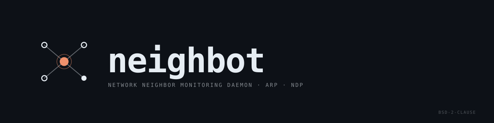

<p align="center">
  
</p>

<p align="center">
  <a href="https://github.com/renaudallard/neighbot/releases/latest">
    
  </a>
  <a href="https://github.com/renaudallard/neighbot/releases">
    
  </a>
  <a href="https://github.com/renaudallard/neighbot/actions/workflows/valgrind.yml">
    
  </a>
  <a href="https://github.com/renaudallard/neighbot/actions/workflows/fuzz.yml">
    
  </a>
  
  <a href="./LICENSE">
    
  </a>
  <a href="https://www.paypal.me/RenaudAllard">
    
  </a>
</p>

---

Like [arpwatch](https://ee.lbl.gov/), but also handles IPv6 and runs on
Linux, FreeBSD, OpenBSD, and NetBSD.

## Features

| | |
|---|---|
| **Protocols** | ARP (IPv4), NDP (IPv6) |
| **Events** | New stations, MAC changes, flip-flops, reappearances, bogons, moves |
| **Notifications** | Email via sendmail with hostname, vendor, and timestamps |
| **Active probing** | ARP requests / NDP solicitations to detect moved vs. multi-homed hosts |
| **OUI database** | Optional hardware vendor identification from MAC prefix |
| **Storage** | Plain CSV with atomic saves (temp file + rename) |
| **VLAN trunks** | Auto-detects VLAN subinterfaces and skips trunk parents; on Linux also skips bond slaves |
| **Sandboxing** | `pledge(2)` + `unveil(2)` on OpenBSD, privilege drop everywhere |
| **Portability** | Linux (glibc, musl), FreeBSD, OpenBSD, NetBSD |

Single-threaded, single binary, no dependencies beyond libpcap.

## Quick Start

```sh
make
sudo ./neighbot -q -f /tmp/neighbot.csv
```

Then generate some traffic (`arping`, `ping`) and watch the log output.

## Build

Requires a C compiler and libpcap.

| OS | Install libpcap |
|----|-----------------|
| Debian / Ubuntu | `apt install libpcap-dev` |
| Alpine | `apk add libpcap-dev` |
| Fedora / RHEL | `dnf install libpcap-devel` |
| FreeBSD / OpenBSD / NetBSD | included in base |

```sh
make
```

## Install

```sh
sudo make install          # binary + man page + OUI database
sudo make install-systemd  # + systemd unit (Linux)
sudo make install-rcd      # + rc.d script (OpenBSD)
make oui-update            # re-download IEEE OUI database
```

Installs to `/usr/local/sbin` by default, with the manual page under
`PREFIX/share/man` (`PREFIX/man` on OpenBSD and NetBSD, where `man` looks
for it). Override with `PREFIX`, `BINDIR` or `MANDIR`. `DBDIR` (default
`/var/neighbot`) sets the database directory built into the binary and
where `oui.txt` is installed:

```sh
sudo make PREFIX=/usr install
```

Uninstall:

```sh
sudo make uninstall
```

### Pre-built packages

`.deb` and `.rpm` packages are built automatically for each GitHub release
and attached as release assets. Supported distributions:

| Format | Distributions |
|--------|---------------|
| `.deb` | Ubuntu (latest supported interim release, if any, and LTS), Debian (stable, oldstable) |
| `.rpm` | Fedora, Rocky Linux (2 versions), openSUSE Leap, SUSE BCI |
| `.apk` | Alpine Linux |
| `.tgz` | OpenBSD (2 latest supported releases) |

Install with your package manager:

```sh
sudo dpkg -i neighbot_*.deb                      # Debian/Ubuntu
sudo rpm -i neighbot-*.rpm                       # Fedora/RHEL/SUSE
sudo apk add --allow-untrusted neighbot-*.apk    # Alpine
doas pkg_add -D unsigned ./neighbot-*.tgz        # OpenBSD
```

## Usage

```
neighbot [-B seconds] [-d] [-e days] [-f dbfile] [-i iface] [-m mailto] [-o ouifile] [-p] [-q] [-r] [-s sendmail] [-u user] [-V]
```

| Flag | Description |
|------|-------------|
| `-B seconds` | Bogon log and notification cooldown in seconds (default: 1800). Set to 0 to disable the per-address cooldown (a global flood cap still applies) |
| `-d` | Daemonize (log to syslog instead of stderr) |
| `-e days` | Drop entries unseen for more than `days` days (checked hourly). 0 disables (default) |
| `-f path` | Database file (default: `/var/neighbot/neighbot.csv`) |
| `-i iface` | Monitor only this interface (default: all Ethernet interfaces) |
| `-m addr` | Email recipient (default: `root`) |
| `-o path` | OUI vendor database file (default: `/var/neighbot/oui.txt`) |
| `-p` | Disable active probing (passive only) |
| `-q` | Quiet mode. No email notifications, events are still logged |
| `-r` | Report mode. Print database summary to stdout (or email with `-m`), then exit |
| `-s path` | Path to sendmail-compatible MTA (default: `/usr/sbin/sendmail`) |
| `-u user` | Drop privileges to this user after opening pcap handles (default: `nobody`) |
| `-V` | Print the version number and exit |

### Examples

```sh
# Foreground, quiet, custom DB
sudo neighbot -q -f /tmp/neighbot.csv

# Daemon with email alerts
sudo neighbot -d -u neighbot -m admin@example.com

# Single interface, no probing
sudo neighbot -d -i eth0 -p

# Print database report to stdout
neighbot -r -f /var/neighbot/neighbot.csv

# Email database report
neighbot -r -m admin@example.com
```

## Event Types

| Event | Description | Email |
|-------|-------------|-------|
| **new** | Previously unknown IP address seen for the first time | yes (suppressed for IPv6 temporary address rotations) |
| **changed** | IP seen with a different MAC than previously recorded | yes |
| **flip-flop** | IP alternates between two known MACs (VRRP/HSRP, dual-homing, or spoofing). Storm detection suppresses rapid repeats, also when three or more MACs take turns (seen as changed events) | yes |
| **reappeared** | Known MAC/IP pair seen again after 6+ months of silence | yes |
| **bogon** | IP outside any local subnet on the receiving interface (possible spoofing). Subnets are re-read every minute, on `SIGHUP`, and before reporting a bogon (at most once a second) | yes |
| **ra-learned** | IPv6 on-link prefix announced by a Router Advertisement | yes (first time only) |
| **moved** | MAC seen at a new IP while old IP no longer responds to probes. The obsolete entry is dropped | yes |

## Active Probing

When a known MAC appears at a new IP, neighbot sends up to 3 probes (5s
timeout each) to each old IP of the same address family associated with that
MAC (dual-stack hosts are not probed across IPv4/IPv6):

- **IPv4**: ARP request sent from the interface's own address, preferably
  one in the target's subnet
- **IPv6**: NDP Neighbor Solicitation sent from the interface's link-local
  address, with a Source Link-Layer Address option

A zero source address is not used: it is what a duplicate address check
looks like (RFC 4862, RFC 5227), and a host that is just bringing up the
probed address would give it up. An interface with no address of the
probed family still sends from `0.0.0.0` or `::`.

| Outcome | Meaning | Action |
|---------|---------|--------|
| Probe answered | Device has multiple IPs | Log only |
| Probe timed out | Device moved to new IP | Log + email |
| Probe timed out with the link down | Unknown (probes were not delivered) | Log only |

Link-local addresses (fe80::/10, 169.254/16) are excluded from probing
since every IPv6 interface has one alongside its global address.
IPs assigned to the local host's own interfaces are also excluded,
preventing false "moved" alerts when the host has multiple IPs across
VLANs or other interfaces.

Disable probing with `-p` for purely passive monitoring.

**IPv6 temporary addresses (RFC 4941):** When a device using privacy
extensions rotates its temporary address, neighbot detects that the same
MAC already has a non-EUI-64 address in the same /64 prefix on the same
interface and suppresses
the "new station" email. Older temporary addresses are not dropped at that
point, since a spoofed address from the owner's MAC could otherwise clear
the way for another MAC to take one over unreported; they are reaped by the
stale non-EUI-64 sweep below. This also covers link-local address rotation
(common on devices with randomized MACs), although link-local entries are
only removed by `-e` idle expiration. At most 256 addresses per MAC
are tracked; a flood of addresses under one MAC beyond that is ignored
(logged once), which a legitimate neighbor never reaches. An address moving
to a MAC already at the limit is still reported as changed but keeps its
previous MAC in the database, and extra rows in an older database file are
skipped at load. This
handling does not depend on probing and also applies with `-p`.

## Obsolete Address Cleanup

neighbot removes entries it knows are no longer valid:

| Source | Trigger | Notification |
|--------|---------|--------------|
| Probe timeout | Old IP no longer responds at the recorded MAC after a probe fires | "moved" email |
| Stale non-EUI-64 IPv6 | Non-EUI-64, non-link-local IPv6 entry unseen for more than 7 days, checked once per hour | silent (logged only) |
| Idle expiration (`-e days`) | `last_seen` older than `days` days, checked once per hour | silent (logged only) |

This reaping is always on so that RFC 4941 privacy addresses left behind
by an offline device or a prefix change do not linger in the `also known
as` line of later notifications. The test is purely the address shape:
any non-EUI-64, non-link-local IPv6 address qualifies. That also covers
RFC 7217 stable-privacy, DHCPv6, and manually assigned global addresses,
which cannot be told apart from privacy addresses by inspection. A host
that keeps such an address but stays silent for more than 7 days has its
entry dropped and is reported as a new station when it reappears. EUI-64
and link-local addresses are never reaped this way. The broader `-e` idle
expiration remains opt-in: without `-e`, non-temporary entries are kept
indefinitely unless a probe confirms the IP is gone.

## IPv6 Prefix Learning (Router Advertisements)

neighbot listens for ICMPv6 Router Advertisements and records every on-link
prefix announced by a router on each interface (Prefix Information Option
with the L flag set, RFC 4861). Addresses that match a learned prefix are
treated as local and no longer produce bogon alerts, even when the host
itself has no IPv6 address configured on that interface.

The first time a new prefix is learned on an interface, neighbot sends an
**ra-learned** notification so the operator is aware of the new subnet.
Subsequent refreshes of the same prefix are silent. Prefix entries expire
after the RA valid-lifetime (capped at 7 days), and a prefix re-advertised
with the L flag and a zero valid-lifetime is withdrawn immediately. Prefix
options without the L flag are ignored, withdrawals included, as RFC 4861
requires.

Incoming Router Advertisements are validated per RFC 4861: only RAs with
an IPv6 hop limit of 255 and a link-local source address are accepted, so
off-link or spoofed advertisements are dropped. A rogue RA sent by an
on-link attacker can still suppress bogon alerts for the prefix it
announces. The first-learn notification surfaces that event, and
deployments that already run RA-Guard or similar L2 filtering retain
protection. Prefixes shorter than /48 are ignored (and logged), so a
rogue RA cannot whitelist a wide slice of the address space with a single
short prefix.

## Service Setup

neighbot exits with status 1 when a monitored interface disappears (a USB
adapter unplugged, a bridge re-created, an interface renamed), since capture
handles cannot be reopened after dropping privileges. The systemd unit
restarts it, and the restarted daemon picks the interface up again; under
OpenBSD rc.d, restart it with `rcctl`.

<details>
<summary><b>Linux (systemd)</b></summary>

```sh
sudo make install-systemd
sudo systemctl daemon-reload
sudo systemctl enable --now neighbot
```

Edit `/etc/systemd/system/neighbot.service` to change options
(e.g. add `-m admin@example.com` to `ExecStart`, remove `-q` to enable email).

</details>

<details>
<summary><b>OpenBSD (rc.d)</b></summary>

The rc script runs neighbot as `_neighbot`. The `.tgz` package creates
that user; when installing from source, create it first (uid 904, as in
the ports tree):

```sh
sudo groupadd -g 904 _neighbot
sudo useradd -u 904 -g _neighbot -c "neighbot daemon" -d /var/empty \
    -s /sbin/nologin _neighbot
sudo make install-rcd
sudo rcctl enable neighbot
sudo rcctl start neighbot
```

Override flags in `/etc/rc.conf.local`. They replace the script's default
flags, so keep `-u _neighbot` (`-d` is already part of the rc script):

```
neighbot_flags=-u _neighbot -o /usr/local/share/arp-scan/ieee-oui.txt -m admin@example.com
```

</details>

## OUI Database

The OUI vendor database is optional and installed by `make install` to
`/var/neighbot/oui.txt`. It is loaded once at startup. If the file is not
found, a warning is logged and neighbot continues without vendor names.

Two file formats are supported:

| Format | Example | Source |
|--------|---------|--------|
| neighbot | `aa:bb:cc Vendor Name` | `make oui.txt` (`make oui-update` refreshes it) |
| arp-scan | `AABBCC\tVendor Name` | `net/arp-scan,-mac` package |

On OpenBSD, install the `arp-scan,-mac` package and point neighbot at
`/usr/local/share/arp-scan/ieee-oui.txt`.

To keep the bundled format current, add a daily job to `/etc/crontab`
(one line). It runs as the user neighbot drops to (`nobody` by default,
`_neighbot` with the OpenBSD rc script), which owns `/var/neighbot`, so
root never writes into a directory an unprivileged user controls, and the
file is only replaced by a complete download:

```
0 3 * * * nobody cd /var/neighbot && curl -fsSL -o oui.raw https://standards-oui.ieee.org/oui/oui.txt && awk '/\(hex\)/ { gsub(/-/,":",$1); v=""; for(i=3;i<=NF;i++) v=v(i>3?" ":"")$i; print tolower($1)" "v }' oui.raw > oui.new && test -s oui.new && mv oui.new oui.txt; rm -f oui.raw oui.new
```

neighbot will pick up the new data on its next restart.

## Database Format

Plain CSV stored at `/var/neighbot/neighbot.csv` by default:

```
ip,mac,interface,first_seen,last_seen,prev_mac
192.168.1.1,aa:bb:cc:dd:ee:ff,eth0,2026-02-23T14:30:00,2026-02-23T15:12:00,00:00:00:00:00:00
fe80::1,11:22:33:44:55:66,eth0,2026-02-23T14:30:05,2026-02-23T15:12:05,00:00:00:00:00:00
```

Timestamps are ISO 8601, local time. The `prev_mac` field stores the
previous MAC address for flip-flop detection. Old database files without
this field are loaded without errors. Fields are not quoted, so interfaces
whose name contains a comma or a control character are not monitored.

Saves are atomic (write to temp file + rename). The entry limit is
100,000 to prevent memory exhaustion from spoofed traffic. If the file
exists but cannot be read in full (read error, not a regular file),
neighbot exits instead of starting with a partial table that the next
save would write over it.

## Signals

| Signal | Action |
|--------|--------|
| `SIGHUP` | Save database to disk, clear storm suppression and re-read interface addresses |
| `SIGTERM` / `SIGINT` | Save database and exit |
| `SIGUSR1` | Dump active probe state to the log |
| `SIGPIPE` | Ignored |

## Security

neighbot drops to an unprivileged user (default: `nobody`) after opening
pcap handles. All supplementary groups are dropped. The default database
directory `/var/neighbot` is chowned to that user and set to mode 0750
before switching; a directory given with `-f` is left untouched and must be
writable by the target user. The database file itself is never chowned by
root: saves replace it with a file created by the target user. Since that
user can write the database and OUI files, control characters in vendor
names are replaced and database rows with control characters in the
interface field are skipped, so they cannot inject terminal escapes into a
report or an alert.

On OpenBSD, neighbot additionally restricts itself using `pledge(2)` and
`unveil(2)`:

| Mode | pledge | unveil |
|------|--------|--------|
| Quiet (`-q`) | `stdio rpath wpath cpath route` | DB directory only |
| With email | `stdio rpath wpath cpath route proc exec dns` | disabled |

All pcap/BPF handles are opened before pledge, so no `bpf` promise is needed.
`route` lets `getifaddrs(3)` re-read the interface addresses every minute.

Each notification is delivered by a short-lived child process (reverse DNS
plus `sendmail`). To keep a flood of events (for example spoofed in-subnet
ARP) from spawning children at packet rate, no more than 32 notification
children run at once; further notifications are suppressed and logged until
the backlog clears.

## Testing

Standalone test harnesses exercise the parser, database loader, database
expiration, OUI loader, probe packet builders, subnet matching, and
notification formatting with known inputs. They link without sanitizers so
they can run under valgrind.

```sh
make test                              # build all test binaries
tests/test_parse                       # run parser tests
tests/test_dbload                      # run database loader tests
tests/test_dbexpire                    # run database expiration tests
tests/test_ouiload                     # run OUI loader tests
tests/test_probe                       # run probe builder and state machine tests
tests/test_capture                     # run capture_is_local subnet tests
tests/test_notify                      # run format_delta and format_timestamp tests
make test-clean                        # remove test binaries
```

With valgrind:

```sh
valgrind --leak-check=full --error-exitcode=1 tests/test_parse
valgrind --leak-check=full --error-exitcode=1 tests/test_dbload
valgrind --leak-check=full --error-exitcode=1 tests/test_dbexpire
valgrind --leak-check=full --error-exitcode=1 tests/test_ouiload
valgrind --leak-check=full --error-exitcode=1 tests/test_probe
valgrind --leak-check=full --error-exitcode=1 tests/test_capture
valgrind --leak-check=full --error-exitcode=1 tests/test_notify
```

A CI workflow (`.github/workflows/valgrind.yml`) runs all tests under valgrind
on every push and pull request.

## Fuzzing

Requires clang with libFuzzer support (included in most clang packages).

```sh
make fuzz                                         # build all three fuzz targets
./fuzz_parse -close_fd_mask=2 -max_total_time=60  # fuzz the packet parser for 60s
./fuzz_dbload -max_total_time=60                  # fuzz the CSV database loader
./fuzz_ouiload -max_total_time=60                 # fuzz the OUI file loader
make fuzz-clean                                   # remove fuzz binaries
```

`-close_fd_mask=2` discards the parser's per-packet log lines on stderr;
sanitizer and libFuzzer reports are still printed.

Each target is built with ASan and UBSan enabled; any UBSan error
aborts the run like an ASan crash.
Crashes and slow inputs are written to the current directory.

## How It Works

1. Enumerates non-loopback Ethernet interfaces via `pcap_findalldevs()`,
   skipping VLAN trunk parents when subinterfaces exist, and on Linux
   bonding slaves (seen through the bond device)
2. Opens one pcap handle per interface with BPF filter:
   `arp or (icmp6 and (ip6[40] == 136 or ip6[40] == 135 or ip6[40] == 134))`
3. Main loop: `poll()` on all handles (1s timeout)
4. **ARP**: extracts sender IP + MAC from requests/replies (skips probes)
5. **NDP**: parses Neighbor Advertisements (type 136) and Solicitations
   (type 135) for link-layer address options (skips DAD); Router
   Advertisements (type 134) feed on-link prefixes to the bogon filter
6. Updates an in-memory hash table; on new/changed entries, logs and
   optionally emails via `fork()`/`exec()` of sendmail

## License

BSD 2-Clause. See [LICENSE](LICENSE).
